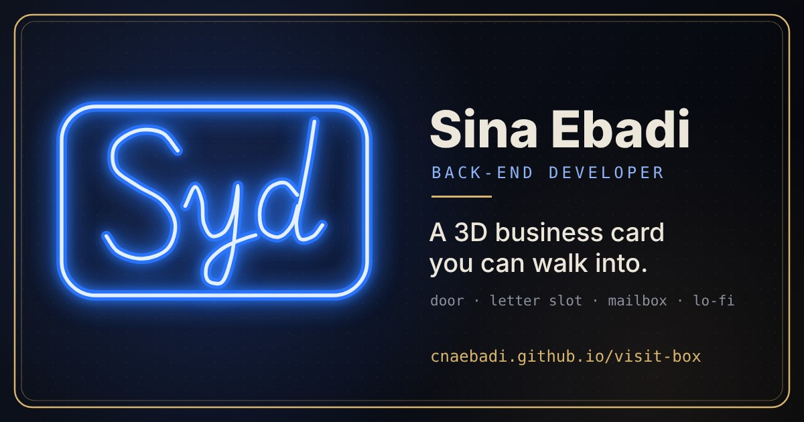

# visit-box · a 3D business card you can walk into

[](https://cnaebadi.github.io/visit-box/)

**Live: [cnaebadi.github.io/visit-box](https://cnaebadi.github.io/visit-box/)**

A cozy little room in the browser. A developer works at his desk under a blue neon sign, rain taps on the window, a Persian cat naps on the shelf and a lo-fi record turns. Open the door on the right wall and you step out onto the other side: the wall is a giant business card. Its only opening is a letter slot. Drop a letter in, and it lands in the mailbox inside the room.

## What you can do

- **Look around**: drag, pinch or scroll. Tap the little robot on the desk and it explains the room.
- **Screens, books, notebook, coffee, crystals**: each one is a link, opened with a small scene of its own (the hand reaches out, the pen writes the email address, the crystals light up…).
- **The door**: walk through it and turn around. You are standing in front of the card, with tappable contact lines, a QR code and "Save contact".
- **The letter slot**: write a letter. It is posted as a GitHub Discussion and shows up in the mailbox inside a minute later, with the owner's reply.
- **The window**: day or night, depending on your clock. Tap the glass and it thunders.
- **Stay a while**: after 30 minutes the room goes quiet and everything alive starts to glow. At 40 minutes, currents of energy flow between them.

## How the mailbox works

```
visitor ── writes a letter ──> GitHub Discussion (category "Mailbox")
                                   │
                    .github/workflows/mailbox.yml
                                   │
                    mail/index.json + mail/p<N>.json  ──>  the mailbox in the room
```

- Letters are paged by discussion number (100 per file), so a run only rewrites the page that changed. It keeps working with any number of letters.
- The room loads the newest letters first and fetches older pages as you scroll.
- Moderation: close or delete a discussion, or add the label `hide`, and it leaves the mailbox.

## Built with

- One `index.html`, no build step. [three.js](https://threejs.org) r170 for the 3D, WebAudio for the sounds (the lo-fi loop is rendered offline in the browser).
- three.js and the fonts are copied into `lib/` by `.github/workflows/vendor.yml`, so the page needs no CDN.
- GitHub Pages, GitHub Discussions and GitHub Actions. That's the whole backend.

## Make your own

1. Fork this repo and enable **Pages** (Settings → Pages → Deploy from a branch → `main` / root).
2. Enable **Discussions** and add a category called **Mailbox** (format: Open-ended discussion).
3. Edit the `CONFIG` block at the top of the script in `index.html`: your links, repos and colors.
4. Run the **Vendor three.js and fonts** workflow once from the Actions tab.

---

Made by **Sina Ebadi** · [GitHub](https://github.com/cnaebadi) · [Telegram](https://t.me/sewyed) · [Instagram](https://www.instagram.com/soluk_10) · [Buy me a coffee](https://www.coffeete.ir/sewyed)
